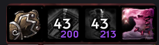

# TrinketCDs (Fork)

> **feralpaw edition** – further customised for WoW 3.3.5a (Frostmourne Rebuffed):
> mouse-drag move mode, overlap protection, snapping, and new defaults (32 px icons; only Trinkets, Hands and Boots active).
>
> Credits: original addon by [Ridepad](https://github.com/Ridepad/TrinketCDs), fork by [suprepupre](https://github.com/suprepupre/TrinketCDs). The upstream repositories have no license file, so all rights remain with them; this fork will be removed on request.


**Fast jump:** [Install](#install) | [Preview](#preview) | [New Features](#new-features) | [Drag & Drop](#drag--drop) | [Profiles](#profiles) | [Proc Glow](#proc-glow) | [Commands](#commands) | [Performance](#performance) | [Options](#options)

> Forked from [Ridepad/TrinketCDs](https://github.com/Ridepad/TrinketCDs).

- Addon dynamically tracks cooldown of equipped trinkets and enchants.
- Made to remove headache of copying/creating weakauras for every new character/item.
- Works both on 3.3 and 3.4 WotLK versions.
- Full database of WotLK/TBC trinkets.
- Ashen rings, cloak, weapon, hands, boots and belt enchants.
- Doesn't depend on combat log.
- Proc duration, stacks, cooldown.
- Cooldown tracking on login and after inventory change.
- Has built-in cooldown text (use [OmniCC](https://www.curseforge.com/wow/addons/omni-cc/files/454434) as alternative).
- Caches cooldown even if trinket was unequipped after proc (useful if server has different iCD on equip).

---

## New Features

### Proc Glow
Visual glow effect around icons when a trinket/enchant proc is active.

- Glow appears automatically when a proc buff is detected
- Three glow styles: **Action Button Glow** (default), **Pixel Glow**, and **Proc Glow**
- Action Button Glow — classic WoW marching ants animation
- Pixel Glow — colored pixel dots orbiting the border
- Proc Glow — WeakAuras-style flipbook proc animation (uses UIActionBarFX spritesheet)
- Per-icon glow toggle for each equipment slot
- Bundled [LibCustomGlow-1.0] with 3.3.5a compatibility
- Dedicated **Glow** settings tab in Interface Options
- Show proc icon instead of item icon while active
- Text (cooldown, stacks, ilvl) always renders above glow effects

### Drag & Drop Positioning
Move trinket icons freely by dragging them with the mouse.

- Toggle with the **Unlock icons** checkbox (Interface → AddOns → TrinketCDs), `/tcd drag`, or the button on the Profiles page
- All icons become visible during drag mode; a **checkmark** on each icon enables/disables it completely
- **Overlap protection:** a dragged icon can't overlap another active icon (it snaps to the nearest free spot). Only the X/Y sliders can overlap icons
- Positions are saved automatically when you release the icon
- X/Y sliders in options update automatically after dragging
- Drag mode is disabled during combat

### Profile System
Save and load complete layouts across all your characters.

- Save current icon positions and all settings as a named profile
- Load profiles on any character on the same account
- Manage profiles via dropdown menu in options or chat commands
- Profiles are stored account-wide in SavedVariables

### Font Settings
Separate font configuration tab with LibSharedMedia-3.0 support.

- Dedicated **Fonts** subcategory in Interface Options
- Dropdown with all fonts from LibSharedMedia-3.0
- Grouped alphabetically with submenus for large font libraries
- Live font preview that updates instantly when selecting a font

---

## Install

- [Download](https://github.com/suprepupre/TrinketCDs/releases/latest).
- Extract `TrinketCDs` folder into `<WoW Folder>/Interface/Addons/` folder.


---

## Preview

### Trinket cooldown example



### All items preview


### Chicken swap preview

Ctrl+Right mouse click to swap to chicken, left mouse click to use. (Ctrl+Right click again to swap back)
> Automatically swaps back to previous trinket after chicken is used, regardless of how chicken was equipped.


---

## Drag & Drop

### How to use
1. Tick **Unlock icons** in Interface → AddOns → TrinketCDs (or type `/tcd drag` / `/tcd unlock`)
2. All icons appear above the options window: green = active, dark = disabled, red = would overlap
3. **Left-click and drag** any icon to move it
4. Click the **checkmark** in an icon's corner to enable/disable that icon completely
5. Untick the box again (or `/tcd lock`) to lock the icons

### Overlap protection
- While dragging, the icon turns red if it would overlap another active icon
- On release it snaps to the nearest free spot; if there is none on screen it moves back
- Disabled icons don't block space
- The X/Y sliders are not restricted, so use them if you want icons to overlap

### Snapping
- Dropping an icon within ~10px of another icon's row/column lines it up exactly (centers, top/bottom or left/right edges)
- Close to a neighbour it docks flush beside, above or below it
- Blue guide lines show the snap while dragging; hold **Shift** while dropping to place freely
- Can be turned off with "Snap icons into line" in the options

### Notes
- Cannot enter drag mode during combat; entering combat locks the icons automatically
- Positions are saved to your character's settings automatically
- X/Y sliders in the options panel update in real-time after dragging
- You can still use X/Y sliders for fine-tuning after drag positioning


---

## Profiles

### What is saved in a profile
- All icon positions (X/Y)
- Icon sizes, zoom, border settings
- Font settings (file, CD size, stacks size, item level size)
- Visibility settings (show/hide individual slots)
- Global switches (combat only, hide ready, proc glow, glow style, etc.)
- Per-icon glow toggle

### Using profiles via chat
```
/tcd save MyLayout      — Save current settings
/tcd load MyLayout      — Load profile
/tcd delete MyLayout    — Delete profile
/tcd profiles           — List all saved profiles
```

### Using profiles via UI
1. Open options: `/tcd options`
2. Go to **TrinketCDs → Profiles** subcategory
3. Select existing profile from dropdown or type a new name
4. Click **Save**, **Load**, or **Delete**

### Sharing layouts between characters
1. Set up your layout on Character A
2. `/tcd save healer_layout`
3. Log in to Character B
4. `/tcd load healer_layout`


---

## Proc Glow

### How it works
- When a tracked item proc buff is active, a glow effect appears around the icon.
- Glow disappears automatically when the buff fades.

### Glow styles
| Style | Description |
|-------|-------------|
| **Action Button** | Classic WoW action bar glow with marching ants animation |
| **Pixel** | Colored pixel dots orbiting the icon border |
| **Proc Glow** | WeakAuras-style animated proc effect using flipbook spritesheet |

### Settings (TrinketCDs → Glow)
- **Enable proc glow** — master toggle for all glow effects
- **Glow style** — dropdown to choose Action Button, Pixel, or Proc Glow
- **Per-icon toggles** — enable/disable glow for each equipment slot

### Defaults
- Proc glow is **enabled**
- Glow style is **Action Button**
- All icons have glow enabled
- Proc icon replacement is **disabled** (item icon stays visible during procs)


---

## Commands

All commands start with `/tcd`:

| Command | Description |
|---------|-------------|
| `/tcd` | Show all available commands |
| `/tcd options` | Open options panel |
| `/tcd drag` | Toggle drag & drop mode |
| `/tcd lock` | Lock icons |
| `/tcd unlock` | Unlock icons |
| `/tcd move` | Same as drag (toggles) |
| `/tcd save <name>` | Save current layout as profile |
| `/tcd load <name>` | Load a saved profile |
| `/tcd delete <name>` | Delete a saved profile |
| `/tcd profiles` | List all saved profiles |
| `/tcd list` | Same as profiles |
| `/tcd cpu` | Show CPU usage stats |

---

## Mouse Controls

| Action | Effect |
|--------|--------|
| **Drag mode: Left-click drag** | Move icon to new position |
| **Ctrl + Left-click** | Reequip trinket to force cooldown |
| **Shift + Left-click** | Swap trinket slots (13↔14) |
| **Alt + Left-click** | Swap to same-name trinket (different ilvl) |
| **Ctrl + Right-click** | Swap to/from chicken trinket |

### Ctrl-click

Reequips trinket to force its cooldown.


### Shift-click

Swaps trinkets places to force cooldown for both.


### Alt-click

Swaps for trinket with same name, but different ilvl (if exists in bag).


---

## Performance

CPU usage from LoD kill


---

## Options

Check in game options for settings. Type `/tcd options` to open.

Settings subcategories:
- **TrinketCDs** — main settings, visibility toggles, trinket swap
- **Trinket1 / Trinket2 / Ring / Belt / ...** — per-icon position, size, zoom, border, font sizes
- **Fonts** — font selection via LibSharedMedia-3.0, live preview
- **Glow** — proc glow enable, style selection (Action Button / Pixel / Proc Glow), per-icon toggles
- **Profiles** — drag mode button, save/load/delete profiles


---

## Changelog

### v2.4.2
- Added 3rd glow style: **Proc Glow** (WeakAuras-style flipbook animation)
- Glow style dropdown now correctly shows selected style with checkmark
- Moved font settings to dedicated **Fonts** subcategory with live preview
- Font preview updates instantly on selection
- Fixed Dislodged Foreign Object not showing proc buff (stacked buff fallback)
- Fixed Action Button Glow overlapping cooldown/stacks/ilvl text
- Text overlay now always renders above all glow effects

### v2.4.1
- Added proc glow effect (Action Button Glow and Pixel Glow)
- Bundled LibCustomGlow-1.0 with LibStub and PoolCompat for 3.3.5a
- Added per-icon glow toggle
- Added Glow settings tab in Interface Options
- Added Drag & Drop icon positioning (`/tcd drag`)
- Added profile system (save/load/delete via chat and UI)
- Added per-character auto-save on logout
- Added Profiles settings tab
- Fixed SetColorTexture missing in 3.3.5a
- Fixed version detection via GetBuildInfo()
- Fixed UI overlap for Profiles panel

### v2.3.0 (upstream)
- Original release by Ridepad

---

## Credits

- Original addon by [Ridepad](https://github.com/Ridepad/TrinketCDs)
- Fork by [suprepupre](https://github.com/suprepupre/TrinketCDs): Drag & Drop, Profiles, Proc Glow, Fonts

---

## Also for WoW 3.3.5a

| Project | What it does |
|---|---|
| [wow_optimize](https://github.com/suprepupre/wow-optimize) | Engine-level optimization DLL - allocator, Lua VM, timers, file I/O, frame-time benchmark |
| [LuaBoost](https://github.com/suprepupre/LuaBoost) | Addon-side GC control, loading-screen helpers, shared APIs for addon authors |
| [WA_SafeGuard](https://github.com/suprepupre/WA_SafeGuard) | Backs up WeakAuras so a forced disconnect cannot wipe your auras |
| [DefileAlert](https://github.com/suprepupre/DefileAlert) | Instant Defile target callout for the Lich King encounter |
